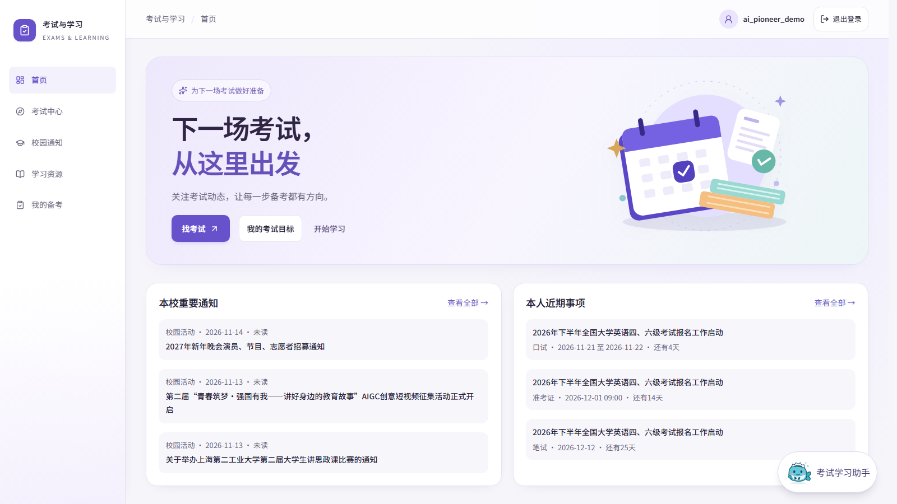
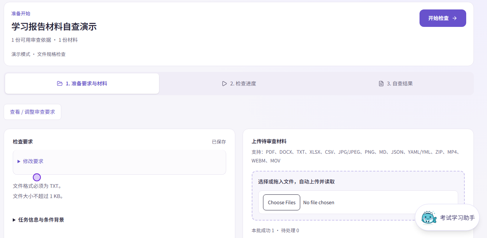
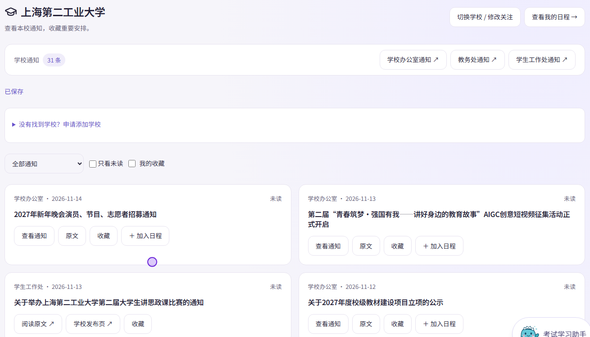
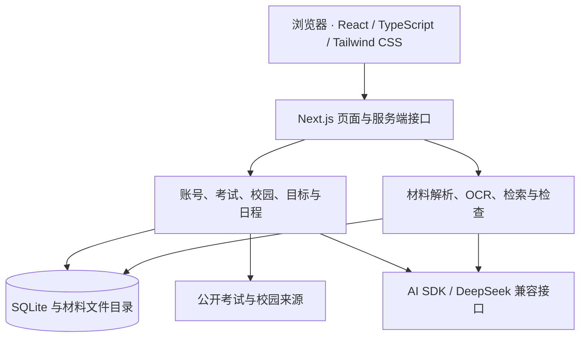

# 考试与学习

**面向在校大学生的个人备考中心，让考试信息、学习安排和材料准备衔接起来。**

[演示视频](https://www.bilibili.com/video/BV1Cssg6AEPu/) · [在线网站](https://43-135-50-146.sslip.io) · [安装运行](#安装运行指南) · [技术文档](docs/submission/technical-document.md) · [团队信息](#团队信息)



## 项目介绍

考试报名、学校通知、课程安排和学习资料分散在不同网站与消息中。找到信息后，还需要记住报名时间、安排学习任务，并按通知准备文件。

“考试与学习”将这些步骤放到同一个网站中：从考试公告建立个人目标，把报名、考试和作业截止时间纳入日程，结合目标查找资料或咨询 AI，再在提交前检查材料是否满足要求。

项目围绕两类需求展开：

- **把信息转化为行动**：连接考试公告、校园通知、个人目标、日程和学习记录。
- **减少材料准备中的遗漏**：从具体通知中整理要求，对照上传材料逐项检查，提供问题依据并支持修改复检。

典型使用路径：**发现考试 → 保存目标 → 安排日程 → 学习与咨询 → 材料自检 → 修改复检**。

## 核心功能

| 功能     | 可以做什么                                                                 |
| -------- | -------------------------------------------------------------------------- |
| 考试发现 | 搜索与筛选考试，查看报名状态、截止倒计时、公告及来源，收藏关注的考试       |
| 我的备考 | 保存考试目标、考期和学习偏好，查看备考路线、待办及学习记录                 |
| 我的日程 | 管理报名、考试、课程考试和作业截止事项，使用日历查看安排，补充时间待定事项 |
| 校园通知 | 按学校名称选择关注学校，浏览已接入来源的公开通知，收藏并关联个人日程       |
| 学习资源 | 按考试目标查找资料、收藏资源、标记已看，并衔接学习计划                     |
| AI 助手  | 咨询考试与学习问题，结合所选目标和站内资料组织回答，查看对应来源           |
| 材料自检 | 导入通知要求、上传文件、查看结论与依据，更新材料后复检并导出报告           |

### 考试材料自检

材料自检帮助用户在提交报名材料、学习报告或申请文件前，按具体通知完成一次自我检查。

1. **提供检查要求**：粘贴通知正文、导入要求文件，或选择已收藏的考试公告。
2. **上传待查材料**：读取文件内容，整理要求与材料的对应关系。
3. **查看检查结果**：先看整体结论和需修改项，再按需展开通知原文与材料证据。
4. **修改并复检**：上传修订文件后提示重新检查，保留历史记录，并支持导出结果报告。

文件格式、大小、数量等明确属性由程序核对；需要理解文本的内容要求，由模型结合检索到的材料片段处理。每项结果区分通过、未通过、待确认、无法检查和不适用。

支持 PDF、DOCX、TXT、Markdown、JSON、YAML、XLSX、CSV、JPG/JPEG、PNG，并提供 ZIP、MP4/WebM/MOV 视频及公开链接的处理入口。

<details>
<summary>查看材料自检界面</summary>



</details>

<details>
<summary>查看校园通知界面</summary>



</details>

## 技术架构

项目采用 Next.js App Router 统一组织页面和服务端接口。浏览器负责交互与结果展示，服务端处理认证、内容管理、文件解析、检索和模型调用；SQLite 与独立文件目录保存业务数据和材料原件。



| 层次       | 技术与职责                                                                          |
| ---------- | ----------------------------------------------------------------------------------- |
| 页面与交互 | React、TypeScript、Tailwind CSS、Radix UI、Lucide；组织考试、备考、日程与自检界面   |
| 服务端     | Next.js Route Handlers、Node.js；处理账号、数据访问、采集和业务流程                 |
| 数据存储   | SQLite（better-sqlite3）；保存账号、公告、个人记录与执行快照，原件保存在材料目录    |
| 文件处理   | PDF.js、Mammoth、ExcelJS、Tesseract.js、Sharp、FFmpeg/FFprobe；读取文档、图片与视频 |
| AI 接入    | Vercel AI SDK、OpenAI 兼容适配器、Zod；组织模型请求并校验结构化输出                 |
| 测试与部署 | Node.js test runner、Playwright、axe；Docker 运行应用，Caddy 提供 HTTPS 代理        |

### AI 技术方案

- **自然语言理解与结构化抽取**：将通知中的材料要求整理为带适用条件、检查参数和原文出处的规则。
- **检索增强生成（RAG）**：按问题或检查要求，从站内资料和材料文本中检索相关片段，再提供给模型组织回答或判断。当前采用关键词、中文二字组及相邻上下文检索。
- **OCR 文字识别**：读取图片与扫描 PDF 中的中英文文字，保留页码、段落和识别区域，供后续检索与证据定位使用。
- **程序与模型协同检查**：程序处理可计算的规格与数值，模型处理文本语义；输出经 Zod 校验，引用需能对应本轮来源或材料。

模型通过服务端兼容接口接入，可通过环境变量配置服务商、接口地址和模型 ID。输入变化后，系统根据规则、来源、背景、材料及执行配置判断复检范围，复用依赖未变的有效结果。

## 安装运行指南

### 在线访问

网站地址：**[https://43-135-50-146.sslip.io](https://43-135-50-146.sslip.io)**

1. 打开网址，先完成浏览器弹出的**入口验证**。验证信息见随作品提供的《访问方式及测试账号》说明。
2. 进入网站后，使用该说明中的**站内测试账号**登录，也可以注册自己的用户名和密码。
3. 登录后从“考试中心”查找考试，在“我的备考”保存目标；学校通知、学习资源和 AI 助手可从对应入口使用。
4. 体验材料自检时，进入“我的备考”，点击**新建材料自查**，填写要求、上传文件并开始检查。

入口验证与站内账号登录是两个步骤，按访问说明分别填写。

### 本地启动

#### 1. 准备环境

- **Node.js 24.x**。
- **pnpm 11.25.0**，可执行 `npm install --global pnpm@11.25.0` 安装。
- **Git**，用于获取源码。

SQLite 使用原生模块。需要本地编译时，Windows 安装 Python 与 Visual Studio Build Tools 的 C++ 工作负载；Linux 安装 Python 3、make 和 g++。详细依赖见[环境配置说明](docs/environment-setup.md)。

#### 2. 获取项目并安装依赖

```sh
git clone https://github.com/qq2173704834/material-review-agent.git
cd material-review-agent
pnpm install --frozen-lockfile
npm rebuild better-sqlite3
```

项目对依赖构建脚本采用显式执行策略，因此首次安装后需单独构建 SQLite 原生模块。

#### 3. 创建环境文件并启动

Windows PowerShell：

```powershell
Copy-Item .env.example .env.local
pnpm dev
```

Windows CMD 的复制命令为 `copy .env.example .env.local`；macOS/Linux 为 `cp .env.example .env.local`，随后同样执行 `pnpm dev`。

打开 **[http://127.0.0.1:3000](http://127.0.0.1:3000)**，注册用户名和密码，保存恢复码后登录。首次运行会创建数据库，默认数据目录为 `.local-data/`。

模板默认 `AI_MODE=mock`，无需模型密钥即可体验页面和材料检查流程；设置真实模型后可使用 AI 生成与语义检查。

<details>
<summary>首次体验：导入仓库中的考试公告</summary>

校园通知和学习资料包含随项目提供的公开数据。全新数据库中的考试公告，可以从仓库快照导入：

```sh
node scripts/import-official-notices.mjs --apply
node scripts/import-official-notices.mjs --batch expansion --apply
```

脚本读取仓库中的既有公告快照并保存至本地数据库；已有公告会跳过。导入内容保留原考期和日期，可用于体验公告、目标与日程关联。使用自定义数据目录时，为命令补充 `--data-dir 目录路径`。

后续可在管理后台配置来源、采集新公告并审核发布。

</details>

### 配置真实 AI

在 `.env.local` 中填写模型服务信息。以下沿用项目模板的 DeepSeek 配置，模型 ID 按控制台实际可用项调整：

```dotenv
AI_MODE=live
AI_PROVIDER=deepseek
AI_BASE_URL=https://api.deepseek.com
AI_MODEL=deepseek-flash
AI_API_KEY=your_api_key
```

保存后重启应用。密钥仅由服务端读取，放在本地环境文件中。调用上限、超时与其他配置项见[环境变量模板](.env.example)和[模型配置说明](docs/model-setup.md)。

### 生产运行与部署

本机生产运行：

```sh
pnpm build
pnpm start
```

服务器部署提供 [Dockerfile](deploy/Dockerfile) 和 [Compose 模板](deploy/compose.yaml)，采用应用容器、Caddy HTTPS 代理及独立数据卷。部署需要配置访问域名、`APP_PUBLIC_ORIGIN` 和环境文件；完整步骤见[环境配置与部署说明](docs/environment-setup.md#docker部署)。

视频材料使用 FFmpeg/FFprobe。Windows x64 提供对应可选依赖；其他平台通过 `FFMPEG_PATH` 和 `FFPROBE_PATH` 配置工具路径，Docker 镜像已安装这两个工具。

## 开发与测试

| 命令                        | 用途                                       |
| --------------------------- | ------------------------------------------ |
| `pnpm dev`                  | 启动本地开发服务                           |
| `pnpm build` / `pnpm start` | 构建并运行生产版本                         |
| `pnpm lint`                 | ESLint 检查                                |
| `pnpm typecheck`            | 路由类型生成与 TypeScript 类型检查         |
| `pnpm test:unit`            | 运行单元测试                               |
| `pnpm test:e2e`             | 验证页面交互与材料自检流程                 |
| `pnpm test:platform`        | 验证账号与平台业务流程                     |
| `pnpm test:model`           | 使用本机受控模型服务验证 AI 接入与审查流程 |

浏览器测试先执行 `pnpm test:install` 安装浏览器，再执行 `pnpm build`。测试使用独立数据目录和合成样例，更多命令与场景见[测试说明](tests/README.md)。

## 项目结构

```text
src/
  app/            页面与 API 路由
  components/     功能组件与交互界面
  domain/         业务类型、数据契约与公开参考数据
  lib/            规则、检索、日期和其他业务逻辑
    server/       认证、存储、采集、解析与模型调用
public/           字体等静态资源
data/             公开数据快照与核对记录
tests/            单元测试、浏览器测试与合成样例
scripts/          数据维护、运行与工程工具
deploy/           Docker、HTTPS 与运维配置模板
docs/             技术、环境和使用文档
```

## 文档导航

- [技术文档](docs/submission/technical-document.md)：需求分析、架构设计、AI 方案、核心实现与测试部署。
- [环境配置说明](docs/environment-setup.md)：本地环境、原生依赖、环境变量与 Docker 部署。
- [模型配置说明](docs/model-setup.md)：兼容接口接入、超时和调用控制。
- [测试说明](tests/README.md)：测试模式、运行方法与场景组织。
- [依赖清单](package.json) · [依赖锁文件](pnpm-lock.yaml) · [依赖构建策略](pnpm-workspace.yaml)。

## 团队信息

本项目为第九届传智杯 AI Web 参赛作品，由 **AI先锋** 团队开发。

| 项目     | 信息               |
| -------- | ------------------ |
| 团队名称 | AI先锋             |
| 参赛成员 | 费咏杰（单人团队） |
| 所属院校 | 上海第二工业大学   |
| 所属专业 | 工程管理           |
| 学历     | 硕士研究生         |
| 指导教师 | 张洋               |

项目使用 Next.js、React、SQLite、AI SDK 及文档解析等开源组件构建，具体依赖与版本见仓库清单。
