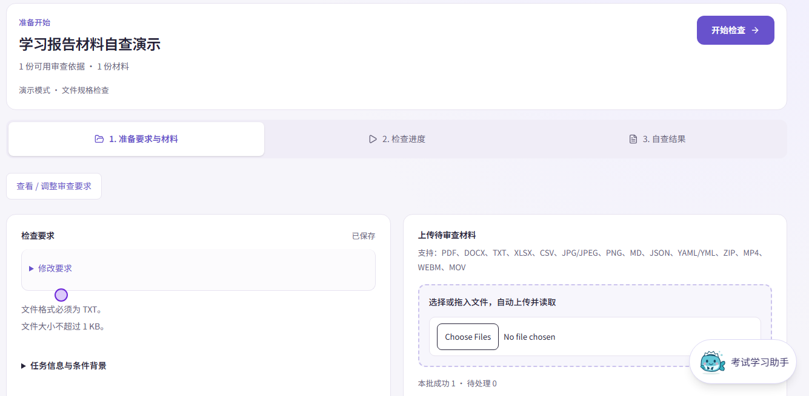
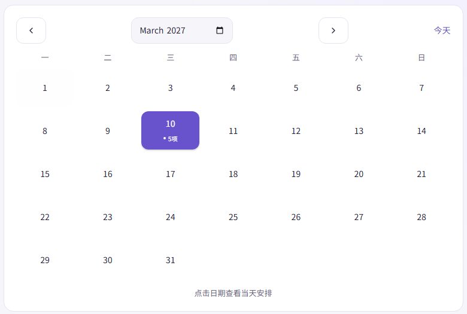
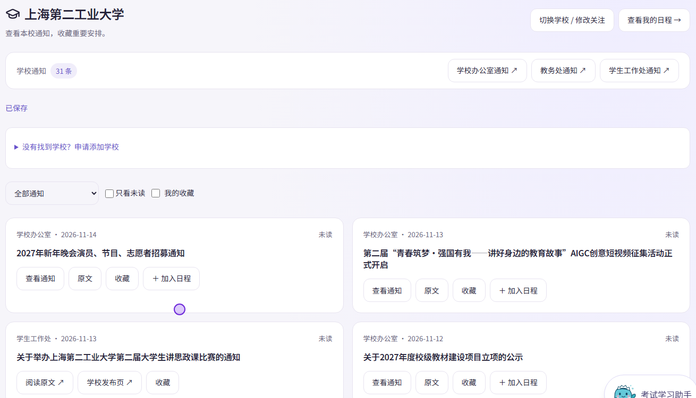

# 考试与学习 技术文档

第九届传智杯 AI Web参赛作品

团队：AI先锋。参赛成员：费咏杰（单人团队）。院校：上海第二工业大学。专业：工程管理。学历：硕士研究生。指导教师：张洋。

版本日期：2026年11月17日。

## 1 项目概述

考试与学习面向在校大学生，把考试信息、校园通知、个人目标与日程、学习资源、AI咨询和考试材料自检整合到同一网站。用户从查找一条公告开始，可以保存目标、安排学习与截止事项，并在提交文件前完成自我检查。

项目要解决两类实际问题：考试、课程和校园信息分散，查到后难以转化为个人安排；材料要求分散在通知正文中，学生容易遗漏规格或内容。系统以个人考试目标串联信息与行动，以“要求、材料、依据、修订复检”组织材料自检。

### 作品与阅读导航

- 第2节分析用户需求，第3节说明系统架构。
- 第4、5节说明AI选型、集成、检索和结果校验。
- 第6至9节说明核心功能、数据与权限实现。
- 第10、11节记录测试、运行环境和部署方式。
- 第12节分别列出技术创新、应用创新及后续方向。

### 团队与项目来源

AI先锋为单人团队，费咏杰负责本项目开发与材料整理，指导教师为张洋。项目在本次参赛前无公开发表或获奖记录，未基于已有完整开源项目、课程项目或其他作品改进。采用Next.js、React等开源框架与依赖构建，版本由源码清单和锁文件记录。

### 体验入口

演示视频：https://www.bilibili.com/video/BV1Cssg6AEPu/

代码仓库：https://github.com/qq2173704834/material-review-agent

网站：https://43-135-50-146.sslip.io。网站设有入口验证，进入后使用网站账号登录。视频及本文截图使用示例账号和材料，AI演示画面保留演示模式标识。

<!-- page -->

## 2 需求分析

### 使用者与操作路径

主要用户是在校大学生，关注考试报名、课程考试、学习资料和材料准备；内容管理员维护公开来源及待发布公告。两类角色分别授权，普通用户管理自己的目标、收藏、日程和材料记录。

典型路径是：查找考试公告，保存个人考试目标，选择适用考期，安排学习与截止时间，使用资料或AI助手，最后按通知要求检查材料。校园通知与私人作业进入对应列表，避免把所有信息混在一个日历中。

| 需求     | 用户操作                       | 实现重点                     |
| -------- | ------------------------------ | ---------------------------- |
| 发现考试 | 搜索、筛选、查看原文、收藏     | 显示来源、报名状态和适用日期 |
| 建立目标 | 保存考试与学习偏好             | 关联公告，衔接资料和日程     |
| 管理时间 | 新建、编辑、完成个人日程       | 区分类型，时间待定单独展示   |
| 关注校园 | 按学校名称选择来源             | 公开通知与个人记录分开保存   |
| 获取帮助 | 查资料、记录已看、向助手提问   | 结合目标与来源组织回答       |
| 检查材料 | 导入要求、上传、检查、修改复检 | 先给结论，问题与依据按需展开 |

### 交互与质量要求

用户首先看到当前结论和下一步，技术信息放在适当层级。更新材料后，旧结论应标记待复检；进入页面与切换阶段不自动产生模型调用。保存成功后清理表单状态，保存失败则保留输入供重试。

账号切换后必须读取当前账号的数据；服务端校验任务归属。文档读取失败、上下文不足和执行中断都需要独立状态，不能合并成通过。桌面与手机保持相同操作能力，日期按适用年份、考期和明确时区处理。

<!-- page -->

## 3 系统架构设计

系统采用Next.js App Router统一组织页面与服务端接口。React、TypeScript和Tailwind CSS构建前端；Node.js服务端处理认证、公开内容、个人数据、文件解析与模型访问。SQLite保存结构化记录，材料文件存入独立数据目录。

<!-- architecture -->

### 数据与代码职责

| 层次       | 主要职责                           | 源码位置                |
| ---------- | ---------------------------------- | ----------------------- |
| 页面与交互 | 首页、考试、日程、校园、资料、自检 | src/app、src/components |
| 业务契约   | 目标、规则、材料、执行状态与校验   | src/domain              |
| 服务端     | 认证、存储、采集、解析、AI接口     | src/lib/server          |
| 规则与检索 | 规格比较、片段检索、一致性判断     | src/lib                 |
| 验证与部署 | 单元、浏览器用例、Docker和HTTPS    | tests、deploy           |

模型密钥不进入浏览器。服务端先验证账号、来源与输入，再访问本地数据和外部模型。上传文件以真实类型和解析状态进入材料记录，公开考试、校园内容与每个用户的私人记录分别管理。

云端由Caddy代理HTTPS请求，应用容器以非root用户运行；数据卷与应用镜像分离，便于升级、备份与恢复。当前实现面向单实例持久化部署。

<!-- page -->

## 4 AI技术方案 选型与集成

### 选型理由

项目接入DeepSeek的兼容接口，承担通知要求提取、材料语义判断和考试学习问答。这些任务包含中文条件理解、内容概括和学习任务拆解，适合使用大模型处理。文件大小、格式、数量等可计算要求交给程序工具，减少重复生成与模糊判定。

采用Vercel AI SDK及OpenAI兼容适配器统一服务调用，使服务商、根地址、模型ID和密钥可以通过环境变量更换。已记录的云端合成联调使用deepseek-flash；后续切换模型时以服务商实际可用ID为准。

### 集成方式

model-client.ts在服务端建立兼容客户端，生成结果通过Zod结构化契约验证。通知要求提取保留要求强度、适用条件、参数与原文引用；材料检查输出判定、理由和证据位置。AI助手按问题类型组织所选考试目标、已收录资料及个人安排的适用上下文。

要求引用需要能在通知原文逐字定位；材料证据需要对应实际材料和片段。校验失败时保留错误或待确认状态，真实模式失败不会静默换成模拟结果。

| 控制项       | 模板默认配置     | 目的                   |
| ------------ | ---------------- | ---------------------- |
| 模式         | AI_MODE=mock     | 无密钥也能复现操作流程 |
| 单步超时     | 60000毫秒        | 限制等待，支持失败提示 |
| 审查步骤上限 | 12               | 限制一次审查的模型使用 |
| 单步尝试上限 | 2次              | 对短暂失败有限重试     |
| 助手限额     | 每账号每小时20问 | 控制持续请求           |

部署时可以收紧配置。凭据、请求记录和必要用量留在服务端管理；普通结果页面和简版报告集中展示结论与问题。

<!-- page -->

## 5 AI技术方案 检索与优化

### 从通知到有依据的结论

系统先把通知整理为规则草稿，再解析上传材料，按每条规则检索相关片段。规格工具直接比较确定属性；内容要求交由模型结合受限上下文判断。最终聚合结论、依据和未完成项，再生成复检计划。

<!-- pipeline -->

### 检索与上下文控制

材料检索使用词法匹配与中文二字组，结合规则参数和有限相关词扩展。文本按2000字符分块、1800字符步进形成重叠，并补充相邻上下文。每次检索最多60片段、24000字符，同时记录覆盖情况。当前实现采用词法检索，不依赖向量数据库。

通知引用包含来源、段落与原文；材料引用包含材料标识、片段序号与原文。解析不完整或检索覆盖不足时，不能把“本次没有找到”直接判成“全文不存在”，相应结果转为待确认或无法检查。

### 减少无效调用并保持可追溯

- 可计算的规格由本地工具完成，语义要求才使用模型。
- 按规则提供相关片段，控制上下文长度和输出契约。
- 规则适用条件、二选一关系和未知条件分别保留。
- 同名材料更新后保留历史版本，比较变化并生成复检计划。
- 提示词把通知和材料中的命令视为数据，执行仅允许预定义能力。

结果分为通过、未通过、待确认、无法检查和不适用。执行失败与尚未执行的项目独立保留，整体结论依据当前有效执行生成。

<!-- page -->

## 6 核心功能实现 材料自检

用户从“我的备考”新建材料自查，粘贴通知、导入要求文件或关联考试公告，再上传材料。准备页展示主要要求、材料列表与开始检查按钮；结果页优先呈现结论、需修改项和下一步，详细证据按需打开。

### 读取与检查

支持PDF、DOCX、TXT等文本、XLSX/CSV及JPG/PNG，另提供受限视频、压缩包和公开链接处理。PDF.js、Mammoth和ExcelJS读取常用文档；Tesseract.js配合图像处理完成中英文OCR。读取不全时保留partial状态，文档段落、表格行或OCR位置用于证据定位。

### 修订与复检案例

演示通知要求TXT且不超过1KB。首次文件超出上限，系统指出大小问题；用户上传精简后的同名文件，页面提示需要重新检查。主动复检后，两项规格要求通过，并可导出简版报告。该案例使用演示模式验证操作流程。

旧执行快照继续保留；新材料、要求或背景变化后，当前结论标记待复检。浏览页面不会重跑检查，用户点击主操作才执行新一轮；报告跟随所选执行记录，避免把旧失败结果误认成新文件的结论。

实现入口：material-parser.ts、review-runner.ts、semantic-review.ts与recheck-plan.ts。

<!-- page -->

## 7 核心功能实现 目标与日程

个人考试目标保存所选考试、关联公告、适用考期和学习偏好。系统读取关联公告中的明确节点，将报名与考试安排连接到个人日程；用户可以补充自己的作业、课程考试与学习事项。

### 信息组织与交互

日程按考试安排、报名与申请、作业与报告、活动与其他分类，可在列表与月历之间切换。时间待定事项单独列出，已知日期按实际日期显示，不为填满日历编造时间。首页的公共考试推荐与本人安排使用不同语义。

新建与编辑使用弹窗，保存成功关闭并清理草稿状态；保存失败保留原输入。完成状态与日程内容分别更新。移动端使用紧凑月历和适合触控的入口，低频设置按需打开。

### 账号与日期一致性

日程、目标与收藏按稳定用户ID读取。换账号后重新读取个人数据，不沿用上个账号的缓存。目标与首页共用适用公告及考期信息，来源缺少时间、尚未选考期和日期已过分别处理。

服务端和浏览器的执行时间采用显式Asia/Shanghai展示，避免UTC服务器与不同浏览器时区造成首屏不一致；用户录入的日期和数据库时间不因此改写。

<!-- page -->

## 8 核心功能实现 校园 资源与助手

### 校园公开通知

用户主要通过学校名称查找并保存关注学校。学校目录与通知来源分别维护，接入状态按真实来源呈现。采集器读取公开入口、列表和详情，保留标题、正文、日期及原文链接；管理员维护内容，失败时保留已有记录和后续重试状态。

### 学习资源

资源按考试方向、内容形式和学习阶段组织考纲、课程、资料与资讯，提供来源、收藏和已看/未看状态。官方入口、参考资料及AI辅助编辑内容保留属性；所选考试目标帮助用户缩小查找范围。

### AI考试与学习助手

右下角原创鲸鱼助手可结合目标、公告、资料、校园及个人日程等适用上下文回答问题。学习计划类问题先给可执行安排，再询问必要补充；报名日期和地区政策类问题需要对应来源与范围。结构化回答保存引用、建议和后续问题，缺少信息时明确指出需要补充的内容。

来源调度与手动审查相互独立。日常采集可以按日运行；新增公开考试公告经过管理员审核后发布，个人材料记录不会作为公共公告发布。

<!-- page -->

## 9 数据与权限设计

### 数据模型与状态

公开内容包含考试公告、学校目录、通知和学习资源；个人数据包含账号、目标、收藏、日程、任务、材料、规则集与执行记录。任务保存材料版本及执行快照，让复检可以比较同一规则下的变化。

| 对象       | 关键关系或状态                 | 用途                     |
| ---------- | ------------------------------ | ------------------------ |
| 账号与会话 | 稳定用户ID、会话哈希、到期时间 | 登录与个人数据隔离       |
| 目标与日程 | 账号、考试、公告、适用考期     | 信息转为个人安排         |
| 材料与规则 | 任务、来源、版本、解析状态     | 判断当前要求和可读取范围 |
| 执行与结果 | 材料快照、规则集、证据、结论   | 历史追溯与重新检查       |
| 公开来源   | 原文、采集状态、更新时间       | 更新内容并保留来源       |

### 登录与访问控制

注册采用用户名与密码，密码以带独立盐的scrypt保存；会话令牌随机生成，数据库保存哈希并设置有效期。恢复码用于重设密码，管理员身份由部署者明确授予。服务端验证账号、任务归属和写请求来源，限制跨账号访问及跨站写入。

### 上传与外部访问

上传检查大小、数量、扩展名和真实签名。Office与压缩材料限制解压规模；图片OCR及视频处理限制资源范围。公开网页获取检查DNS解析结果与重定向各跳地址，阻止本机和内网目标，并限制时长及响应大小。

环境文件、数据库、上传原件、备份与私钥排除出Git和构建上下文。模型仅能使用预定义检查能力，材料里的命令不能变成工具权限。备份与恢复覆盖结构化数据和材料，升级时持久卷保持独立。

<!-- page -->

## 10 测试方案与已验证结果

项目将确定性逻辑、浏览器流程与真实模型接入分开验证。测试使用独立数据目录、合成账号与材料；固定回答用于检查系统处理，真实模型样例用于核对实际兼容接口和业务接入。

| 验证层次       | 已记录结果                                  | 证明的范围                             |
| -------------- | ------------------------------------------- | -------------------------------------- |
| 单元与工程检查 | 最新135项单元通过；构建、Lint、类型检查通过 | 规则、解析、数据与状态等自动回归       |
| 受控审查流程   | 28项通过，含电脑和手机                      | 固定模型回答下的引用、失败、复检与报告 |
| 云端浏览器     | 38个检查点通过                              | 日程、入口、复检、历史、移动端及时区   |
| 真实AI接入     | 云端3次合成调用完成                         | 学习建议、要求提取与材料语义检查       |
| 依赖与交付     | 生产及全依赖审计0项已知漏洞                 | 当前审计库和锁定版本范围               |
| 运维           | 备份独立恢复、健康检查通过                  | 当次部署与恢复流程                     |

### 关键回归内容

覆盖账号切换、跨账号读取拒绝、跨站写入拒绝、日程编辑与保存、通知变更后的规则过期、同名材料更新、待复检提示、一次点击一次执行、证据定位和简版报告。异常用例覆盖格式错误、截断、超时、取消、低覆盖及模型输出不符合契约。

真实云端联调的3次合成请求共5510 Token；后续部署验收未追加模型调用。该记录用于确认接入链路，不作为大规模准确率或用户满意度指标。视频中的助手与自检使用演示模式。

### 复现命令与记录位置

先执行pnpm install --frozen-lockfile与pnpm test:unit。浏览器测试先pnpm test:install、pnpm build，再按tests/README.md选择test:e2e、test:model、test:platform或test:access。各Playwright配置定义独立服务和数据目录。

详细样例在tests/；已有工程与部署结果记录保留在Git开发历史。当前材料整理没有重新运行全部应用测试，也未新增真实模型请求。

<!-- page -->

## 11 运行环境与部署

### 本地复现

使用Node.js 24与pnpm 11.25.0。在项目根目录复制.env.example为.env.local，执行pnpm install --frozen-lockfile，再运行pnpm dev，访问http://127.0.0.1:3000。生产运行先pnpm build，再pnpm start。

完整依赖在package.json和pnpm-lock.yaml，构建策略在pnpm-workspace.yaml。better-sqlite3需要匹配当前Node版本的原生模块；首次安装缺少绑定时，准备C++及Python工具后执行npm rebuild better-sqlite3，也可使用包含构建步骤的deploy/Dockerfile。

### 配置要点

| 配置         | 内容                                                           |
| ------------ | -------------------------------------------------------------- |
| AI模式与凭据 | AI_MODE；AI_PROVIDER、AI_BASE_URL、AI_MODEL、AI_API_KEY        |
| 调用控制     | AI_TIMEOUT_MS、AI_MAX_CALLS_PER_REVIEW、AI_MAX_ATTEMPTS        |
| 数据与账号   | REVIEW_DATA_DIR、REVIEW_AUTH_MODE=accounts                     |
| 公网来源     | APP_HOST、APP_PUBLIC_ORIGIN，配置为实际HTTPS地址               |
| 调度与媒体   | EXAM_SCHEDULER、AUTO_REVIEW_ENABLED、FFMPEG_PATH、FFPROBE_PATH |

默认mock不需要外部服务。启用live后由服务端读取真实配置；模型ID以服务商可用值为准。密钥不写入页面、README和视频。

### 云端与数据持久化

已采用腾讯云Ubuntu服务器部署，Docker构建Node24应用，Caddy提供HTTPS与入口验证，应用3000端口仅映射服务器环回。数据保存在独立卷，升级替换镜像前备份并验证恢复。运行环境另有每日采集、每日备份和周期巡检配置。

部署模板为deploy/environment.private.example和deploy/compose.private.yaml。复制环境模板、设置镜像标签与实际来源后运行Docker Compose。环境、原生模块、媒体工具、完整启动命令及备份方式见源码docs/environment-setup.md。

本地交付源码包含后续文案与依赖修订；云端仍为此前已验收版本，不能把Git更新视为自动部署。在线评审需要单独交付可用入口及普通体验账号，并在评审期间保持服务。

<!-- page -->

## 12 创新点 总结与展望

### 技术创新点

第一，将通知要求转为带出处、强度、条件和参数的结构化规则，再选择确定性工具或语义模型执行。文件属性直接比较，内容判断提供材料证据，统一的结果状态贯穿页面、复检和报告。

第二，把检索覆盖与解析完整性纳入判定流程。词法检索提供受限片段及邻近上下文，结果结合真实引用校验；无法覆盖的内容保留待确认，避免因上下文缺失直接下结论。

第三，将来源、规则、材料和执行记录关联为可追溯快照。修订材料后明确标记待复检，保留原结果，新的有效执行再生成当前结论，减少旧结果被误用。

### 应用创新点

以大学生个人考试目标连接公开信息与个人行动。考试公告可以衔接目标、学习资源和日程；校园通知与作业、课程考试纳入同一备考场景，同时按信息类型组织。

将材料自检做成备考中的一个具体工具。学生不需要理解规则编号和模型参数，即可按“提供要求、上传文件、查看问题、修改复检”完成自查。助手回答、资料查找和材料检查围绕同一目标提供帮助。

### 总结与展望

项目已形成考试发现、个人目标、日程、校园资源、AI咨询与材料自检的完整使用路径，并完成分层测试和云端部署验证。展示强调学生当前需要处理的事情，详细依据按需查阅。

后续优先提高考试和学校来源覆盖，完善日期归并及更新质量；积累经人工核对的材料样例，分别评估要求提取和语义判断。面向更多并发用户时，再根据真实负载扩展存储、队列和监控；视觉与信息密度继续结合学生使用反馈调整。

### 文档与项目入口

README包含项目介绍、技术架构、安装指南与完整团队信息；环境模板、依赖锁文件和测试用例随源码提供。完整Git提交历史保留在托管仓库，并附离线历史副本供复核。

视频：https://www.bilibili.com/video/BV1Cssg6AEPu/

仓库：https://github.com/qq2173704834/material-review-agent
